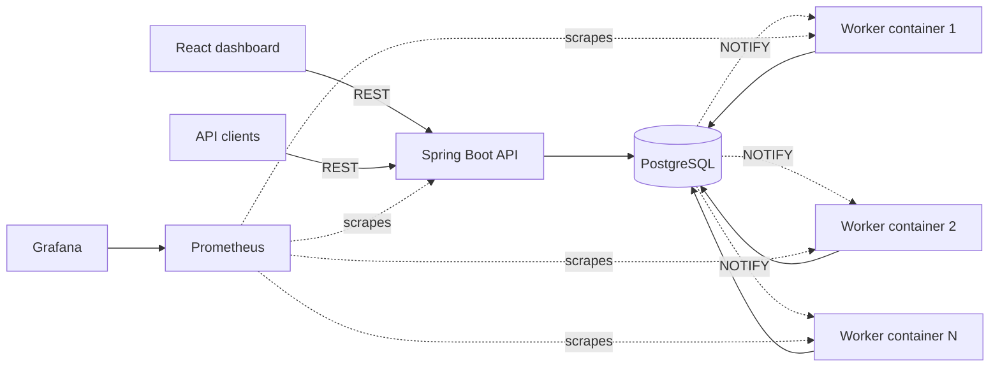
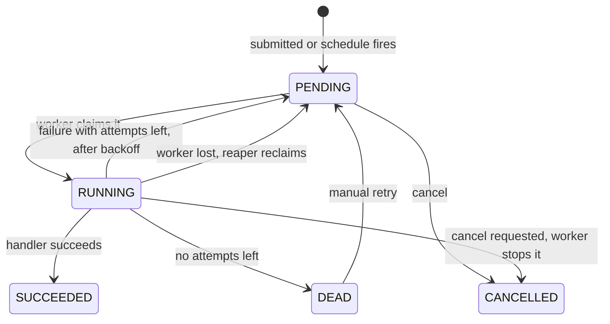

# JobQueue

[](https://github.com/shivam4589/JOB-SWAGGER/actions/workflows/ci.yml)

**Live demo: https://job-swagger.onrender.com** (free hosting, so it can take about a minute to wake up after being idle; looking around is public, creating or changing jobs asks for an admin login).

A distributed background-job queue built on **PostgreSQL**, with a **Spring Boot** API, horizontally scalable **worker containers**, a **React dashboard**, and **Prometheus / Grafana** monitoring.

Clients submit jobs over REST. A fleet of worker containers claims them safely (no job is ever handed to two workers), retries failures with exponential backoff, parks hopeless jobs in a dead-letter state, and recovers jobs from workers that crash. Recurring jobs run on cron schedules. Everything runs with one `docker compose up`.

## Features

- **Safe concurrent claiming**: workers claim jobs with `SELECT ... FOR UPDATE SKIP LOCKED`, so any number of workers can poll one table without blocking each other or running a job twice.
- **Retries with exponential backoff and jitter**, then a **dead-letter** state after the attempt limit. Dead jobs can be retried manually.
- **Crash recovery with a lock heartbeat**: workers keep refreshing the lock of the jobs they run, so a long job is never mistaken for an abandoned one, while a crashed worker is detected quickly. Verified by killing a worker container mid-job.
- **Instant wake-ups** through PostgreSQL `LISTEN/NOTIFY`: a new, retried or delayed job starts within milliseconds instead of waiting for the next poll. Polling stays as a fallback.
- **Recurring jobs**: cron schedules (5- or 6-field cron, time zones), fired exactly once even with many worker containers ticking at the same time.
- **Idempotency keys**: repeat a submit with the same `Idempotency-Key` and get the original job back instead of a duplicate.
- **Job results**: a handler can return a result that is stored with the job and shown in the API and the dashboard. The built-in `GENERATE_REPORT` job type builds a summary of the queue itself.
- **Concurrency limits per job type**: cap how many jobs of one type run at once across all workers, and the cap is exact even when many workers claim at the same moment.
- **Per-client API keys**: each application gets its own key that can submit jobs; every job records who submitted it, keys can be disabled, and idempotency keys are scoped per client.
- **Schedule run history**: each recurring schedule shows its recent runs with their status and results, and a click opens the job.
- **Per-client rate limits and daily quotas**: an API client can be capped (jobs per minute, jobs per day); the limit is exact even under concurrent requests, and an over-limit submit gets `429` with `Retry-After`.
- **A real `WEBHOOK` job type**: calls a URL with retries and backoff and stores the response as the job's result, with protections against being used to reach internal addresses.
- **Data retention**: old finished jobs (and their attempt history) are deleted automatically in small batches.
- **Priorities, delayed jobs, cancellation of waiting *and running* jobs** (a running job is interrupted at the worker's next heartbeat), and a full per-attempt audit trail (worker, timing, error).
- **React dashboard**: live stats, paged and filterable job list, job details with attempts, create/cancel/retry, schedules page.
- **Observability**: Prometheus metrics (queue depth, throughput, duration and queue-wait percentiles, retries, dead letters) and a provisioned Grafana dashboard.
- **Tested**: unit tests plus integration tests against real PostgreSQL (Testcontainers), including concurrency tests. CI runs everything on every push.

## Architecture



The API and the workers are the same Spring Boot application started in different modes (`JOBQUEUE_WORKER_ENABLED`). PostgreSQL is the only shared state: it is the queue, the audit log, the lock manager and the wake-up channel.

### Job lifecycle



## Quick start

Requires Docker (Docker Desktop on Windows/macOS). About 4 GB of RAM available to Docker is comfortable.

```bash
git clone https://github.com/shivam4589/JOB-SWAGGER.git
cd JOB-SWAGGER
docker compose up -d --build --scale worker=2
```

The first build takes a few minutes. Then:

| What | Where |
|---|---|
| REST API | http://localhost:8081 |
| Swagger UI | http://localhost:8081/swagger-ui.html |
| Grafana dashboard | http://localhost:3000 (anonymous viewer; `admin` / `admin` to edit) |
| Prometheus | http://localhost:9090 |
| PostgreSQL | `localhost:5432`, user / password / database `jobqueue` |

Run the dashboard (needs Node 18+):

```bash
cd frontend
npm install
npm run dev      # http://localhost:5173, proxies /api to localhost:8081
```

### Try it

```bash
# submit a job (the Idempotency-Key header is optional)
curl -X POST localhost:8081/api/jobs \
  -H "Content-Type: application/json" -H "Idempotency-Key: order-1001" \
  -d '{"type":"SEND_EMAIL","payload":{"to":"user@example.com"},"priority":7}'

# the same request again returns the same job with 200 and "Idempotent-Replayed: true"

# a recurring job: every weekday at 09:00 India time
curl -X POST localhost:8081/api/schedules \
  -H "Content-Type: application/json" \
  -d '{"name":"daily-report","type":"SEND_EMAIL","payload":{"to":"team@example.com"},"cron":"0 9 * * 1-5","timezone":"Asia/Kolkata"}'

# queue statistics
curl localhost:8081/api/stats
```

Built-in demo job types: `SEND_EMAIL` (simulates 300 ms of work), `NOOP`, `SLOW` (`{"seconds": N}`), and `ALWAYS_FAIL` (to watch retries and dead-lettering). To add a job type, implement the `JobHandler` interface and annotate the class with `@Component`.

### Crash recovery demo

```bash
# submit a 20-second job and see which worker container is running it
curl -X POST localhost:8081/api/jobs -H "Content-Type: application/json" \
  -d '{"type":"SLOW","payload":{"seconds":20}}'
docker compose exec postgres psql -U jobqueue -c "SELECT id, status, locked_by FROM jobs WHERE status='RUNNING';"

# kill that container (the first 12 characters of locked_by are the container id)
docker kill <container-id>

# about 30 seconds later the reaper reclaims the job and another worker finishes it
docker compose logs -f worker
```

The job's attempt history then shows the lost attempt (`Worker lost: lock expired`) followed by a successful attempt on a different worker. A healthy worker running the same job for much longer than the lock timeout is *not* disturbed, because its heartbeat keeps the lock fresh.

## API

| Method | Path | Description |
|---|---|---|
| `POST` | `/api/jobs` | Submit a job. Optional `Idempotency-Key` header. `201` when created, `200` plus `Idempotent-Replayed: true` for a repeat, `422` if the key was used for a different request |
| `GET` | `/api/jobs` | List jobs. Filters `status`, `type`; paging `limit`, `offset`; total in the `X-Total-Count` header |
| `GET` | `/api/jobs/{id}` | Job details |
| `GET` | `/api/jobs/{id}/attempts` | Every attempt: worker, timing, error |
| `DELETE` | `/api/jobs/{id}` | Cancel a job. `PENDING`: cancelled at once (`200`). `RUNNING`: cancellation is requested and the worker interrupts the handler within one heartbeat (`202`, the job shows `cancelRequested: true` until it stops). `409` if it already finished |
| `POST` | `/api/jobs/{id}/retry` | Re-queue a `DEAD` job with a fresh attempt budget |
| `GET` | `/api/stats` | Counts per status, jobs finished in the last minute, longest wait |
| `GET`, `POST`, `DELETE` | `/api/limits`, `/api/limits/{type}` | List, set (`{"type","maxConcurrent"}`) or remove a concurrency limit |
| `POST` | `/api/clients` | Create an API client. The response contains its key, shown only once |
| `GET` | `/api/clients` | List API clients (admin login). `POST /api/clients/{id}/disable` and `/enable` switch a key off or on |
| `POST` | `/api/clients/{id}/limits` | Set a client's `ratePerMinute` and/or `dailyQuota` (omit or `null` = unlimited). Over-limit submissions get `429` with `Retry-After` |
| `GET` | `/api/schedules/{id}/runs` | The most recent jobs a schedule created, newest first, with status and result (`limit` 1-50) |
| `POST` | `/api/schedules` | Create a recurring job (5- or 6-field cron, or `@daily` style macros; IANA time zone) |
| `GET` | `/api/schedules`, `/api/schedules/{id}` | List or read schedules |
| `POST` | `/api/schedules/{id}/pause`, `/resume`, `/trigger` | Pause, resume, or run once now |
| `DELETE` | `/api/schedules/{id}` | Delete a schedule (jobs it already created are kept) |
| `GET` | `/actuator/health`, `/actuator/prometheus` | Health and metrics |

Submit body: `type` and `payload` are required; `priority` (1-10, default 5), `delaySeconds` (default 0) and `maxAttempts` (1-20, default 5) are optional. Errors are returned as RFC 7807 problem details. When `JOBQUEUE_ADMIN_PASSWORD` is set, every `POST`, `PUT`, `PATCH` and `DELETE` under `/api` needs HTTP Basic credentials, while reading stays open (this is how the public demo is protected). Instead of the admin login, an API client can submit jobs with `Authorization: Bearer <key>`; a key can do nothing else, and listing the clients needs the admin login.

## How it works

### Claiming jobs without double execution

```sql
UPDATE jobs
SET status = 'RUNNING', locked_by = :worker, locked_at = now(), attempts = attempts + 1
WHERE id = (
    SELECT id FROM jobs
    WHERE status = 'PENDING' AND run_at <= now()
    ORDER BY priority DESC, run_at
    FOR UPDATE SKIP LOCKED
    LIMIT 1
)
RETURNING *;
```

`SKIP LOCKED` makes a worker pass over rows another worker is already claiming instead of waiting for them. A partial index on pending jobs keeps the lookup cheap. A concurrency test runs 10 threads against 500 jobs and asserts every job is claimed exactly once.

### Retries, dead letters and lost workers

- A failed attempt goes back to `PENDING` with `run_at` pushed out by `base * 2^(attempt-1)` (capped), plus +/-25% random jitter so retries do not arrive in a burst. After `maxAttempts` the job becomes `DEAD`.
- While a worker runs a job, a **heartbeat** refreshes the job's `locked_at` every few seconds. A scheduled **reaper** (one per worker container, safe thanks to `SKIP LOCKED`) re-queues `RUNNING` jobs whose lock has gone stale for longer than the lock timeout, or dead-letters them if no attempts are left. A crashed worker stops refreshing, so it is detected after the timeout; a slow but healthy job is not. The open attempt record of a reclaimed job is closed as failed.
- Every status change is guarded by `locked_by`. If a worker was reclaimed anyway, its late result updates zero rows and cannot overwrite the new owner's.

### Instant wake-ups

Database triggers send `NOTIFY jobqueue_jobs` when a job is inserted or goes back to `PENDING`. Each worker container keeps one dedicated connection that `LISTEN`s on that channel and wakes its idle threads. An idle thread otherwise sleeps until the earliest waiting job is due (found with one cheap indexed query), so retries and delayed jobs start on time without busy polling; a longer safety timeout covers anything missed. If the `LISTEN` connection cannot be made (for example behind a transaction-mode connection pooler) or drops, workers fall back to plain polling and the listener keeps retrying. A test sets the poll interval to 30 seconds and still expects jobs to finish within seconds.

### Cancelling a running job

Cancelling a waiting job is a single `UPDATE`. For a running job the API only sets a `cancel_requested` flag. The database answers every worker heartbeat with that flag; when it is set, the worker interrupts the thread running the handler, closes the attempt as cancelled and marks the job `CANCELLED`. The interrupt is delivered under a lock that checks the thread is still running that job, so a thread that has already moved on is never hit by mistake, and an end-to-end test checks the worker keeps processing jobs afterwards. If a worker dies after the request, the reaper cancels the job instead of re-queuing it. Cancellation is cooperative: handlers that sleep or block on I/O stop immediately, while one that ignores interrupts simply finishes.

### Recurring jobs

Each worker container checks for due schedules every few seconds. The check locks due schedule rows with `SKIP LOCKED`, inserts the job and moves `next_run_at` forward **in a single transaction**, so a due run is fired by exactly one container and never half-applied. Runs missed while workers were down are not replayed: one job is created and the next run is the first occurrence after now. A test fires one due schedule from four threads at once and asserts exactly one job is created.

### Idempotency keys

The key is stored on the job behind a unique index, and the insert uses `ON CONFLICT DO NOTHING`, so simultaneous requests with one key create exactly one job. The request is fingerprinted (SHA-256 of the canonical JSON after defaults are applied), so reordered JSON fields count as the same request while a different request under the same key is rejected with `422`. Keys are remembered as long as their job exists, so they expire when the retention cleanup deletes the job.

### Data retention

A background task deletes finished jobs older than the configured limits (7 days for `SUCCEEDED`, 30 days for `DEAD` and `CANCELLED` by default), oldest first, in batches of 1,000 using `SKIP LOCKED`. Attempt history is removed together with its job; `PENDING` and `RUNNING` jobs are never touched. This keeps the table small, which also matters on small hosted databases.

### Job results

A handler that implements `ResultJobHandler` returns a JSON result; the worker stores it in the same statement that marks the job `SUCCEEDED`, so a job never shows as finished without its result. Results over 64 KB are replaced by a short summary. `SEND_EMAIL` returns a delivery receipt, `SLOW` the time it slept, and `GENERATE_REPORT` a snapshot of the queue (jobs per status and per type, longest wait).

### Concurrency limits

Limits live in a small table. While none exist, claiming is the plain `SKIP LOCKED` query and costs nothing extra. Once any limit exists, workers claim inside a short transaction that first takes a PostgreSQL advisory lock, then excludes every job type that already has `max_concurrent` jobs running. Because claims are serialised and each commits before the next starts, two workers can never both take the last free slot; a test claims from 8 threads at once and checks the limit holds exactly. Other worker processes notice a new limit within about 2 seconds.

### API clients

A key is 256 random bits (`jq_...`); only its SHA-256 hash is stored, so a database leak does not reveal keys and a lost key cannot be recovered, only replaced. A filter in front of the API accepts either the admin login or a key; a key may only `POST /api/jobs`, and the job is stamped with the client that sent it. Idempotency keys are scoped per client by a unique index on (client, key), so two clients can reuse the same key safely.

### Quotas and rate limits

A client's limits are checked when it submits a job. Its submissions are serialised with a per-client advisory lock; the job is inserted, the counts (last 60 seconds, and since 00:00 UTC) are read **including** the new job, and if a limit is exceeded the exception rolls the insert back. This keeps the limit exact even when many requests arrive at the same moment (a test sends 12 at once against a limit of 5 and expects exactly 5 to succeed), and a replay of an earlier idempotent request creates nothing, so it never counts. Clients without limits skip all of this.

### Webhook jobs

`WEBHOOK` payload: `{"url": "https://...", "method": "POST", "headers": {...}, "body": {...}}`. Anyone who can submit a job chooses the URL, so the handler only allows `https`, refuses credentials in the URL, refuses private, loopback, link-local and cloud-metadata addresses, never follows redirects, limits headers, times out, and reads at most 64 KB of the response. A response that is not 2xx fails the attempt, so the normal retries with backoff apply. A test runs the handler against a real local HTTP server and checks each refusal.

### Delivery guarantees

Execution is **at-least-once**: if a worker dies after doing the work but before recording it, the job runs again, so handlers should be idempotent. Idempotency keys give effectively-once *submission*.

## Benchmarks

Everything (PostgreSQL 16, API, workers, load generator) ran on one laptop in Docker Desktop with 4 CPUs and about 3.7 GB of RAM, so treat these as relative numbers, not absolute capacity. Each worker container runs 4 polling threads. Reproduce with `loadtest/run-loadtest.ps1` (PowerShell; it empties the jobs tables first). These numbers were measured before the heartbeat, `LISTEN/NOTIFY` and retention changes were added.

**Queue overhead** (`NOOP` jobs, 5,000 per run):

| Workers | Threads | Jobs | Seconds | Jobs/sec | Duplicate attempts | Failed |
|---|---|---|---|---|---|---|
| 1 | 4 | 5000 | 15.74 | 317.7 | 0 | 0 |
| 3 | 12 | 5000 | 10.25 | 487.6 | 0 | 0 |
| 6 | 24 | 5000 | 27.56 | 181.4 | 0 | 0 |

**Scaling with real work** (`SEND_EMAIL`, about 300 ms of simulated work per job, 1,000 per run):

| Workers | Threads | Jobs | Seconds | Jobs/sec | Duplicate attempts | Failed |
|---|---|---|---|---|---|---|
| 1 | 4 | 1000 | 82.46 | 12.1 | 0 | 0 |
| 2 | 8 | 1000 | 45.94 | 21.8 | 0 | 0 |
| 4 | 16 | 1000 | 30.07 | 33.3 | 0 | 0 |

- **Correctness under load:** no job was attempted twice across 18,000 job runs, with up to 24 threads claiming jobs at the same time.
- **Queue overhead:** one container processes about 320 no-op jobs/sec and three reach about 490. At six containers throughput drops, most likely because seven JVMs plus PostgreSQL compete for 4 CPUs. That reflects the test machine, not the design, but I have not isolated the cause.
- **Scaling:** with I/O-bound jobs, throughput grows from 12.1 to 33.3 jobs/sec (2.75x) going from 1 to 4 containers. Each added container helps a bit less because all of them share the same CPUs and database.

## Monitoring

Prometheus scrapes the API and every worker container (new containers are discovered automatically); Grafana ships with a provisioned **JobQueue overview** dashboard.

| Metric | Meaning |
|---|---|
| `jobqueue_jobs{status}` | Jobs per status (gauge, read from PostgreSQL by the API) |
| `jobqueue_oldest_pending_age_seconds` | Wait of the longest-waiting runnable job |
| `jobqueue_job_duration_seconds` | Time inside the handler, by `type` and `outcome` (histogram) |
| `jobqueue_job_queue_wait_seconds` | Time between a job becoming due and a worker picking it up (histogram) |
| `jobqueue_job_retries_total`, `jobqueue_job_dead_total` | Retries scheduled and jobs dead-lettered |
| `jobqueue_reaper_reclaimed_total` | Jobs recovered from lost workers |
| `jobqueue_heartbeat_lost_total` | Heartbeats for jobs a worker no longer owned |
| `jobqueue_retention_deleted_total` | Old jobs deleted by the retention cleanup |
| `jobqueue_schedules_fired_total` | Recurring-schedule runs |

## Configuration

Set as environment variables (see `docker-compose.yml`).

| Variable | Default | Meaning |
|---|---|---|
| `DB_URL`, `DB_USER`, `DB_PASSWORD` | local Postgres | Database connection (use a direct, non-pooled connection so `LISTEN` works) |
| `PORT` | `8080` | HTTP port (hosting platforms set this) |
| `JOBQUEUE_WORKER_ENABLED` | `false` | Run worker threads, reaper, scheduler, heartbeat and retention in this process |
| `JOBQUEUE_WORKER_CONCURRENCY` | `2` (compose: `4`) | Polling threads per container |
| `JOBQUEUE_WORKER_POLL_INTERVAL_MS` | `500` | Sleep between polls when the queue is empty and `LISTEN` is not connected |
| `JOBQUEUE_WORKER_LISTEN_ENABLED` | `true` | Wake workers through `LISTEN/NOTIFY` |
| `JOBQUEUE_WORKER_LISTEN_SAFETY_POLL_MS` | `5000` | Longest an idle worker sleeps while `LISTEN` is connected |
| `JOBQUEUE_WORKER_BACKOFF_BASE_SECONDS`, `..._MAX_SECONDS` | `2`, `300` | First retry delay and its cap |
| `JOBQUEUE_WORKER_LOCK_TIMEOUT_SECONDS` | `120` (compose: `30`) | A running job whose lock was not refreshed for this long is considered abandoned |
| `JOBQUEUE_WORKER_HEARTBEAT_INTERVAL_MS` | `10000` (compose: `3000`) | How often running jobs' locks are refreshed (keep well below half the lock timeout); also how quickly a cancel request reaches a running job |
| `JOBQUEUE_WORKER_REAPER_INTERVAL_MS` | `15000` (compose: `5000`) | How often the reaper runs |
| `JOBQUEUE_WORKER_SCHEDULER_INTERVAL_MS` | `5000` | How often schedules are checked |
| `JOBQUEUE_RETENTION_ENABLED` | `true` | Delete old finished jobs automatically |
| `JOBQUEUE_RETENTION_SUCCEEDED_DAYS`, `..._FAILED_DAYS` | `7`, `30` | How long `SUCCEEDED`, and `DEAD` / `CANCELLED`, jobs are kept |
| `JOBQUEUE_RETENTION_INTERVAL_MINUTES`, `..._BATCH_SIZE` | `60`, `1000` | Cleanup frequency and batch size |
| `JOBQUEUE_WEBHOOK_ALLOW_PRIVATE_NETWORKS` | `false` | Let webhook jobs call private, loopback and link-local addresses (only for trusted setups) |
| `JOBQUEUE_WEBHOOK_ALLOW_HTTP` | `false` | Let webhook jobs use plain `http://` |
| `JOBQUEUE_WEBHOOK_TIMEOUT_SECONDS`, `..._MAX_RESPONSE_BYTES` | `10`, `65536` | Webhook timeout and how much of the response is read |
| `JOBQUEUE_ADMIN_USER`, `JOBQUEUE_ADMIN_PASSWORD` | unset | When the password is set, changes under `/api` need HTTP Basic login (reading stays open) |
| `JOBQUEUE_CORS_ALLOWED_ORIGINS` | `localhost` and `127.0.0.1`, any port | Origins allowed to call the API from a browser |

## Deployment

The live demo runs as a single container (`Dockerfile.deploy`: dashboard + API + workers) on Render's free tier with a free Neon PostgreSQL database. Step-by-step instructions, including the environment variables, are in [`docs/DEPLOY.md`](docs/DEPLOY.md). The free service sleeps when idle, so background work only runs while it is awake.

## Tests and CI

```bash
mvn test        # Docker must be running: integration tests start real PostgreSQL containers
```

- Unit tests: backoff policy, cron parsing and time zones.
- Integration tests against PostgreSQL (Testcontainers): the REST API, claiming under concurrency, worker end-to-end (exactly-once, retries, dead letters), retry scheduling and crash recovery, the lock heartbeat (a job longer than the lock timeout runs once), `LISTEN/NOTIFY` wake-ups, data retention, cancel/retry/stats/paging/CORS, cancelling running jobs, concurrency limits (exactness under concurrency), job results, API keys, client quotas under concurrency, schedule run history, webhook calls against a local test server, recurring schedules (including simultaneous ticks), idempotency keys (including a race), the admin login filter, and the metrics endpoint.
- GitHub Actions runs the whole suite and builds the Docker images on every push.

## Design decisions and limitations

- **PostgreSQL as the queue instead of Kafka or RabbitMQ.** One dependency, transactional, durable, and easy to inspect with SQL. The cost is lower throughput than a dedicated broker and table churn from frequent updates, which relies on autovacuum and the retention cleanup.
- **At-least-once, not exactly-once, execution.** A worker that dies after finishing the work but before recording it causes a re-run. Handlers need to be idempotent.
- **Cancelling a running job is cooperative.** The worker interrupts the handler thread, so handlers that sleep or block on I/O stop promptly, but a handler that ignores interrupts (for example a tight CPU loop) cannot be stopped and finishes normally. A cancel request takes effect within one heartbeat interval.
- **`LISTEN/NOTIFY` needs a direct database connection.** Behind a transaction-mode pooler it cannot work and the workers fall back to polling, so jobs start a little later but nothing breaks.
- **Recurring jobs:** missed runs are not replayed, and a new run can start while the previous one is still running. Schedules cannot fire more often than every 10 seconds.
- **Idempotency keys are scoped per API client** (anonymous submissions share one scope) and are forgotten when retention deletes the job.
- **Concurrency limits trade some claim throughput for exactness.** While any limit exists, claims are serialised by a short database lock. Limits are per job type, not per client or per queue.
- **API keys are minimal.** They can only submit jobs, there are no per-client quotas or rate limits, and reading the dashboard and jobs stays public.
- **Webhook safety has one known gap.** The target address is checked and then connected to separately, so a hostile DNS server could answer differently the second time (DNS rebinding). Closing it needs pinning the connection to the checked address. A webhook that returns 4xx is retried like any other failure.
- **Quotas count accepted jobs.** A rejected submission costs nothing, but the `Retry-After` for the per-minute limit is a conservative 60 seconds rather than the exact moment a slot frees.
- **Retention deletes data by design.** Raise the limits (or disable it) if you need a longer history.
- **Priorities are strict**, so a steady stream of high-priority jobs can starve low-priority ones.
- **Authentication is minimal.** There is one optional admin login for write requests, no users or roles. CORS is limited to localhost by default.
- **Benchmarks come from a single laptop** and show relative behaviour only.

## Project structure

```
src/main/java/com/example/jobqueue/
  api/        REST controllers, service logic, admin login filter, error handling, CORS
  domain/     Job, JobAttempt, JobStats, JobStatus
  repo/       JobRepository (all job SQL)
  worker/     WorkerLoop, WakeSignal, JobNotifier, LockHeartbeat, StuckJobReaper, BackoffPolicy, JobHandler and demo handlers
  schedule/   cron schedules: repository, service, scheduler, controller
  retention/  cleanup of old finished jobs
  limits/     concurrency limits per job type
  clients/    API clients and keys
  metrics/    QueueMetrics (Prometheus gauges)
src/main/resources/db/migration/   Flyway migrations V1-V13
src/test/java/                     unit and integration tests
frontend/                          React + Vite dashboard
monitoring/                        Prometheus config, Grafana provisioning and dashboard
loadtest/                          load-test script and results
docs/DEPLOY.md                     free deployment guide (Render + Neon)
Dockerfile, docker-compose.yml     local development
Dockerfile.deploy                  single-container image for hosting
.github/workflows/ci.yml           CI pipeline
```

## Roadmap

- [x] REST API, PostgreSQL schema, Docker Compose
- [x] Workers with `SKIP LOCKED` claiming
- [x] Retries with backoff, dead letters, stuck-job reaper
- [x] Cancel, retry, stats, filtering and paging, CORS, dashboard
- [x] CI and load tests
- [x] Recurring (cron) jobs
- [x] Idempotency keys
- [x] Prometheus metrics and Grafana dashboard
- [x] Public demo (Render + Neon free tier)
- [x] Lock heartbeat, `LISTEN/NOTIFY` wake-ups, data retention
- [x] Cooperative cancellation of running jobs
- [x] Per-job-type concurrency limits, job results, per-client API keys
- [x] Per-client quotas and rate limits, results for scheduled jobs in the schedule view, a real webhook job type
- [ ] Ideas: real e-mail delivery (needs SMTP credentials), pinning webhook connections against DNS rebinding, per-queue priorities
